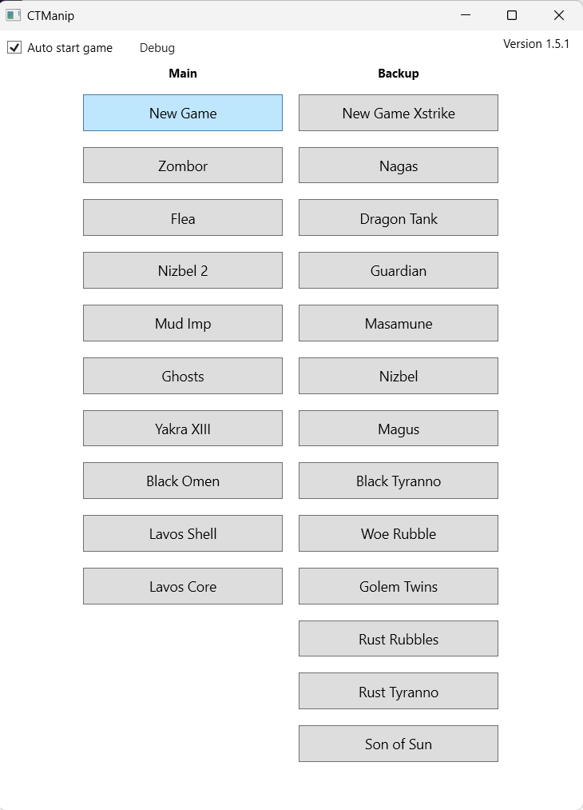

# CTManip

A manip tool for **Chrono Trigger on PC (Steam)**. Pick a manip, and CTManip sets your system date, time and time zone to the values that manip needs, starts the game, and puts your clock back once the game is running.

**Windows 10 or newer only.** Older Windows versions are untested and unsupported.

> [!WARNING]
> CTManip changes your system clock. Changing the clock can cause data loss, broken software, network problems and instability. Use it at your own risk; I take no responsibility for any damage.



## The manips and route

Which manip to use when, and the scripts that go with each seed, are written up here:
**[Chrono Trigger PC - 100% RNG Manip Simple walkthrough](https://staging.onemus.net/speedruns/ct/rng-manip-100-simple/newgame/)**

### What each manip covers

Most Main manips set a seed that carries through several fights, so one click covers all of these:

| Manip | Covers |
| --- | --- |
| New Game | Nagas, Yakra, Dragon Tank, Zombor, Masamune, Nizbel |
| Zombor (backup) | Masamune, Nizbel (skips the Silver Earring, fewer room transitions) |
| Zombor Silver | Masamune, Nizbel, for a route that picks up the Silver Earring |
| Flea | Slash, Magus |
| Nizbel 2 | Black Tyranno (Azala sleeps on the first try) |
| Mud Imp | Golem Twins |
| Ghosts | Rust Tyranno, Son of Sun |

## Download

Get the latest `CTManip_v….zip` from the [Releases page](https://github.com/valheru7/CTManip/releases) and unzip it. It's a single `CTManip.exe` with everything built in, so there's nothing else to install.

## Before you start: turn off UAC

**User Account Control (UAC) must be turned off.** Changing the date and time needs admin rights. If something goes wrong, you can lose internet access until your clock is fixed (see [Troubleshooting](#troubleshooting)).

## Use it

1. In Chrono Trigger, get to the save, autosave or Resume bookmark you want to manip from.
2. Close the game (Alt+F4).
3. In CTManip, click the manip you want.
4. CTManip starts the game through Steam (or start it yourself, see [Steam or no Steam](#steam-or-no-steam)). Load your save (or Resume bookmark).

Your date, time and time zone are set when you click, and put back automatically a moment after the game starts.

### Steam or no Steam

**With Steam** (Auto start game on):

- Put Steam in **Offline Mode** first (Steam menu → **Go Offline**). Online, Steam reacts badly to the date and time changing.
- CTManip starts the game through Steam for you.

**Without Steam** (Auto start game off):

- Run the Chrono Trigger exe directly. Uncheck **Auto start game**, click the manip, then start the game right away.
- This can be a bit quicker than going through Steam.
- Steam's turbo isn't there, so you'll need another tool for it, such as JoyToKey.

### Options

- **Auto start game** (on by default): CTManip starts the game for you. Turn it off to start the game yourself, but start it right away: if the game isn't running within about 6 seconds, CTManip gives up and puts your clock back.
- **Main and Backup**: Main manips set up a seed that carries through several fights (New Game, for example, follows all the way through Nizbel 1). Backup manips mostly cover one fight and don't follow the whole seed; use them to get back on track.
- **Debug → Base RNG**: runs a manip for any of the 255 possible starting battle RNG values. Enter the value in hex (01–FF).

## Troubleshooting

All of these commands go in a **Command Prompt opened as administrator**.

| Problem | Fix |
| --- | --- |
| No internet after a manip | Run `w32tm /resync` |
| The clock doesn't fix itself | Run `w32tm /register`, then `w32tm /resync` |
| Wrong time zone after closing CTManip | Right-click the clock in the taskbar → **Adjust date and time** → set your time zone |

## Building from source

CTManip is a WPF app on .NET 10. With the .NET 10 SDK on Windows:

```
dotnet publish CTManip/CTManip.csproj -c Release
```

That makes the same single, self-contained `CTManip.exe` as the releases. GitHub builds every push, and pushing a version tag (like `v1.5.2.2026.10.25.CT`) makes the release zip and a draft release.

## Credits

- Based on the wonderful work in [FF34Manip](https://github.com/Ricky-James/FF34Manip) by Ricky James.
- [OnemusCT](https://github.com/OnemusCT): the post-launch timing buffer, the Base RNG debug menu, and the manip route write-up.
